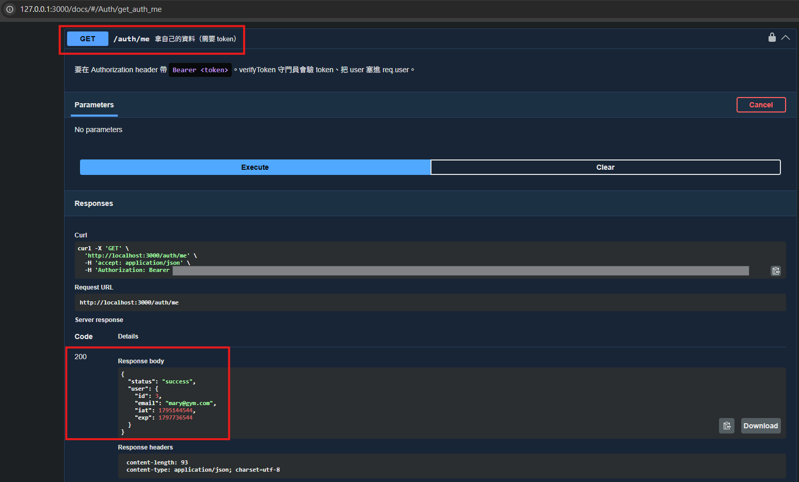

# Node.js JWT 會員驗證 API

以健身房後台為情境，練習使用 Express 建立註冊與登入 API、以 bcrypt 雜湊密碼，並用 JWT 保護個人資料路由。

**技術**：Node.js、Express、bcrypt、jsonwebtoken<br>
**驗證工具**：Swagger UI、Postman、Jest、Supertest<br>
**本機重現**：請參考[快速開始](#快速開始)，啟動後可透過 Swagger UI 操作 API。

## 我的實作範圍

課程提供專案骨架、Swagger API 規格、初始測試資料、Postman Collection 和驗收測試。本人的實作與修改如下。

| 程式碼 | 本人完成或修改的內容 |
|---|---|
| [`middlewares/verifyToken.js`](middlewares/verifyToken.js) | 撰寫 JWT 驗證中介層，從 `Authorization` 標頭取出 Bearer token，並使用 `jwt.verify()` 驗證。通過後將 token 內容放入 `req.user`，再呼叫 `next()` 讓路由繼續處理。未帶授權資料或驗證失敗時回傳 `401`。 |
| [`routes/auth.js`](routes/auth.js) | 完成註冊、登入與個人資料查詢共 3 支 API。註冊時檢查信箱與密碼是否填寫、信箱是否重複，並使用 bcrypt 雜湊密碼後再儲存。登入時比對密碼，驗證成功後簽發 JWT。`GET /auth/me` 受 JWT 驗證保護，驗證通過後回傳 token 中的使用者資料。 |
| [`app.js`](app.js) | 組裝 Express 應用程式，掛載 CORS、JSON 請求解析與 `/auth` 路由，並加入 `404` 回應及集中式錯誤處理。匯出 `app`，讓伺服器啟動與課程測試可分別使用。 |

## API 功能

| 方法與路徑 | 功能 | 成功回應 |
|---|---|---|
| `POST /auth/register` | 檢查註冊欄位與信箱是否重複，將密碼雜湊後儲存 | `201`，註冊成功 |
| `POST /auth/login` | 比對帳號與密碼，驗證成功後簽發 JWT | `200`，回傳 token |
| `GET /auth/me` | 驗證 Bearer token，回傳 token 內的使用者資料 | `200`，回傳 `user` |

## Swagger UI 手動驗證紀錄

- 驗證日期：2026-11-20
- 驗證環境：本機
- 驗證工具：Swagger UI（ http://localhost:3000/docs ）
- 驗證範圍：註冊、登入、個人資料查詢與 JWT 驗證

| 編號 | API | 操作情境 | 預期結果 | 實際結果 | 判定 |
|---|---|---|---|---|---|
| 01 | `POST /auth/register` | 使用尚未註冊的測試信箱與密碼 | `201`，回傳「註冊成功」 |  `201`，「註冊成功」 | 通過 |
| 02 | `POST /auth/register` | 使用同一信箱再次註冊 | `400`，回傳「信箱已被註冊」 |  `400`，「信箱已被註冊」 | 通過 |
| 03 | `POST /auth/login` | 使用案例 01 的正確帳密登入 | `200`，回傳 `token` | `200`，回傳 `token`  | 通過 |
| 04 | `POST /auth/login` | 使用已註冊的信箱與錯誤密碼 | `401`，回傳「帳號或密碼錯誤」 |  `401`，「帳號或密碼錯誤」 | 通過 |
| 05 | `GET /auth/me` | 帶入案例 03 回傳的有效 token | `200`，回傳 `user.id` 與 `user.email`，信箱與登入帳號一致 | `200`，回傳 `user.id` 與 `user.email`，信箱與登入帳號一致 | 通過 |
| 06 | `GET /auth/me` | 清除 Swagger UI 授權，再送出請求 | `401`，回傳「請先登入」 | `401`，「請先登入」 | 通過 |
| 07 | `GET /auth/me` | 設定無效 token，再送出請求 | `401`，回傳「Token 無效或已過期」 | `401`，「Token 無效或已過期」 | 通過 |

### Swagger UI 實測截圖

**案例 05｜帶有效 token 查詢 `/auth/me`，回傳 HTTP 200**



### 驗證摘要

- 共 7 個案例，通過 7 項、未通過 0 項、待驗證 0 項。
- 異常或補充說明：無。

## 我對驗證流程的理解

- **註冊｜`bcrypt.hash()`**：先檢查信箱與密碼是否有填寫，以及信箱是否已被註冊。檢查通過後，將密碼轉為雜湊值，再把帳號存入記憶體。
- **登入｜`bcrypt.compare()` 與 `jwt.sign()`**：使用 bcrypt 比對輸入的密碼與已儲存的雜湊值。帳號不存在或密碼錯誤時，都回傳 `401` 與相同的錯誤訊息。比對成功後，簽發包含使用者 `id` 與 `email` 的 JWT，有效期為 30 天。
- **查詢個人資料｜`jwt.verify()` 與 `next()`**：呼叫 `GET /auth/me` 時，中介層從 `Authorization` 標頭取出 Bearer token，驗證簽章與有效期。通過後，把 token 中的資料放入 `req.user`，再呼叫 `next()` 交給路由回應。未帶授權資料或 token 驗證失敗時，回傳 `401`。

## 專案限制

- **資料儲存在記憶體**：本作業未串接資料庫。伺服器重啟後，執行期間新增的帳號會消失。
- **個人資料取自 token**：`GET /auth/me` 回傳 `req.user`，也就是驗證後的 JWT payload。這支 API 不會重新查詢帳號或確認資料是否已更新。


<br>
<br>
<br>

**------------------------------------------------------------- 以下是原課程作業說明 ------------------------------------------------------------**
<br>
<br>


# 第四週作業：健身房 Admin 登入系統（JWT + bcrypt）

## 情境與任務描述

第三週使用 Express 完成會員的 CRUD 跟圖片上傳。接著我們要將第四週學習的主題：**middleware、bcrypt、JWT** 等概念整合，協助將健身房後台加上**登入系統**，實作出註冊、登入、取得個人資料三支 API，並透過 JWT verify 保護需要登入才能存取的路由。

---

## 快速開始

### Step 1：環境準備

1. 確認 Node.js 版本 >= 18（建議 20）
2. 下載此專案，並打開終端機輸入：`npm install`

### Step 2：設定環境變數

手動新增 `.env`，並將環境變數範例檔（`.env.example`）內容複製到 `.env`（或者可打開終端機輸入：`cp .env.example .env`）

不可把 `.env` 推上 GitHub（`.gitignore` 目前已有排除）

### Step 3：寫作業前先打開 Swagger UI

啟動 server：`npm start`，開啟瀏覽器前往 `http://localhost:3000/docs`。Swagger UI 已預先設定好，啟動後即可查看。

**Swagger UI 是這週唯一 API 規格來源** — 每個 endpoint 點進去能看到完整的 request / response schema，建議先瀏覽各 endpoint 的規格，幫助理解作業任務的撰寫方向。（完成作業後也可點擊 **Try it out** 直接在頁面測試 API。）

### Step 4：開始寫作業

本週共五個任務，需完成以下 3 個檔案：`middlewares/verifyToken.js`、`routes/auth.js`、`app.js`，請依照各檔案的註解說明，來完成對應的功能要求。
（**不需更動**：`server.js`、`test.js`、`fixtures/swagger.json`、`fixtures/users.json`）

```js
// 任務一舉例：
// ───────────────────────────────────────────────────────────
// TODO 任務一：JWT 守門員（verifyToken）
// ───────────────────────────────────────────────────────────

// - 輸入：req.headers.authorization（格式：'Bearer <token>'）
// - Authorization 格式驗證：沒帶或不符合 'Bearer <token>' 格式 → return 401 + { status: 'false', message: '請先登入' }
// - Token 驗證：取出 authorization 中 Bearer 後的 token，在 try/catch 中以 jwt.verify 驗證（secret 用 process.env.JWT_SECRET）；
//   驗證成功則將 decoded 掛到 req.user 並呼叫 next()；
//   驗證失敗（拋出例外）→ catch 中 return 401 + { status: 'false', message: 'Token 無效或已過期' }

/**
 * JWT 守門員：驗 Authorization header 的 Bearer token
 * @param {import('express').Request} req
 * @param {import('express').Response} res
 * @param {import('express').NextFunction} next
 */
const verifyToken = function (req, res, next) {
  /* 作答區 */
};
```


### Step 5：測試你的程式碼

```bash
# 起 server + Postman / Swagger UI （同學自行練習）
npm start

# 執行完整 Jest 測試（繳交作業前需整體通過）
npm test       
```

（這個部分的詳細可參照下方 **驗證與測試** 的說明）


---

## 專案架構

```text
node-js-week4-2026/
├── app.js                       # ← 任務五：組裝 app（需撰寫）
├── server.js                    # npm start 啟動點（不需更動）
├── middlewares/
│   └── verifyToken.js           # ← 任務一：JWT verify（需撰寫）
├── routes/
│   └── auth.js                  # ← 任務二～四：註冊、登入、讀取（需撰寫）
├── test.js                      # Jest + supertest（不需更動）
├── fixtures/
│   ├── users.json               # 預填一個 hash 好的管理員（不需更動）
│   └── swagger.json             # swagger API 文件（不需更動）
├── .env.example
├── .gitignore
├── package.json
```

---

## 主線任務

### 【任務一：middlewares/verifyToken.js】

* 讀取 `req.headers.authorization`，header 沒帶、格式錯誤就回應 **401** 跟相關訊息
* `jwt.verify` 驗證失敗，回應 **401** 跟相關訊息
* 驗證通過：`req.user = decoded` + 呼叫 `next()`

### 【任務二：POST /auth/register】

* 如果欄位缺少 email 或 password，就回應 **400** 跟相關訊息
* 如果 email 判斷已存在，回應 **400** 跟相關訊息
* 密碼需使用 bcrypt 來加密處理
* 成功註冊：回應 **201** 跟相關資訊（status、message）

### 【任務三：POST /auth/login】

* 帳號不存在 / 密碼錯誤，都是回應 **401** 跟一致的錯誤訊息（帳號或密碼錯誤），避免帳號探測
* 驗證通過：使用 `jwt.sign` 簽發 token，回應相關資訊（status、token）

### 【任務四：GET /auth/me】

* 使用 `verifyToken` middleware 驗證
* 從 `req.user` 取得使用者資料並回傳

### 【任務五：app.js 組裝】

* 依序掛載：跨域、JSON body 解析等 middleware，接著是 Swagger UI（已預先提供）以及 `/auth` router
* 加上 404 middleware（無此路由），以及錯誤處理 middleware（4 個參數，放在最後）
* `module.exports = app`（不需呼叫 `app.listen`）

---

## 驗證與測試

### 【驗證】

驗證部分提供給同學在作業進行中或撰寫完成後**自行練習**，透過實際發送 request、觀察回應結果，也能更直觀地了解各 API 的運作方式。

使用前需先執行 `npm start` 啟動本地 server。

**方式一：Postman Collection**

此專案附有 `week4_postman_collection.json`，匯入 Postman 後即可快速測試各 API。
關於匯入流程、相關操作步驟，以及一些注意事項，可參考 [Week4 Postman Collection 教學](https://hackmd.io/@hexschool/ryX32aMlMe)

**方式二：Swagger UI**

開啟瀏覽器前往 `http://localhost:3000/docs`，可在各個 API 項目點擊 **Try it out** 直接在頁面測試。


### 【測試】

**作業繳交前必須通過**，執行 `npm test` 來確認各個測試項目。

測試結果條列：

- ✓ 表示測試通過
- ✕ 表示測試失敗

最終看到 `Tests: 16 passed, 16 total` 即代表全數通過。

**測試項目（共 16 項）**

| 群組 | 測試數 |
|---|---|
| 任務一：verifyToken 守門員 | 3 |
| 任務二：POST /register | 4 |
| 任務三：POST /login | 3 |
| 任務四：GET /me | 2 |
| 任務五：app.js 整合| 4 |

---

## 繳交方式

1. 完成 `middlewares/verifyToken.js`、`routes/auth.js`、`app.js` 中的所有函式
2. 執行 npm test 確保所有測試通過
3. 將程式碼上傳至 GitHub
4. 提交 GitHub 連結

---

## 常見問題

**Q：`/auth/me` 回 401？**
A：這個 endpoint 需帶上 `Authorization: Bearer <token>` 這樣的 header，所以可先檢查這個部分唷（token 可透過 `POST /auth/login` 拿取）

**Q：`bcrypt.hash` / `bcrypt.compare` 拿到 Promise 物件、不是字串 / boolean？**
A：記得加上 `await`。`bcrypt.hash` 和 `bcrypt.compare` 都是 async，所以 handler 要寫成 `async function`。

**Q：`jwt.verify` 沒有 throw，但 `req.user` 是 undefined？**
A：`jwt.verify` 成功會回傳 decoded payload，需要我們手動把它設置到`req.user`。（最後記得要 `next()`）

**Q：測試有一條「壞掉的 JSON body」在測什麼？**
A：這是測試**錯誤處理守門員（4 參數）**有沒有運作。`express.json()` 遇到格式錯誤的 JSON 會丟出 `SyntaxError`，Express 自動交給 4 參數的 error handler 處理。如果少寫 / 寫成 3 參數，這條測試就不會通過。

**Q：fixtures 裡密碼長一串 `$2b$10$...` 是什麼？**
A：這是 bcrypt 加密後的雜湊值（`$2b$` 是演算法、`10` 是加鹽次數）。fixtures 預填的明文密碼是 `1q2w3e4r`，所以用 `bcrypt.compare('1q2w3e4r', <雜湊值>)` 會回傳 `true`。
